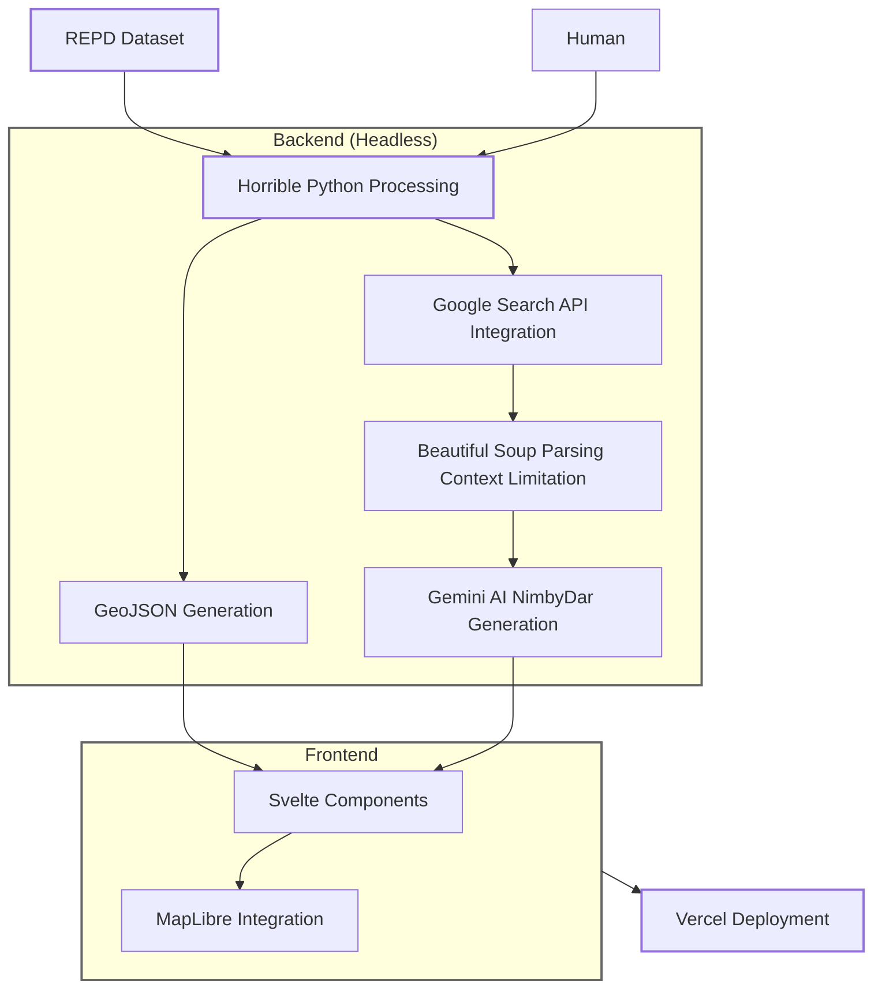
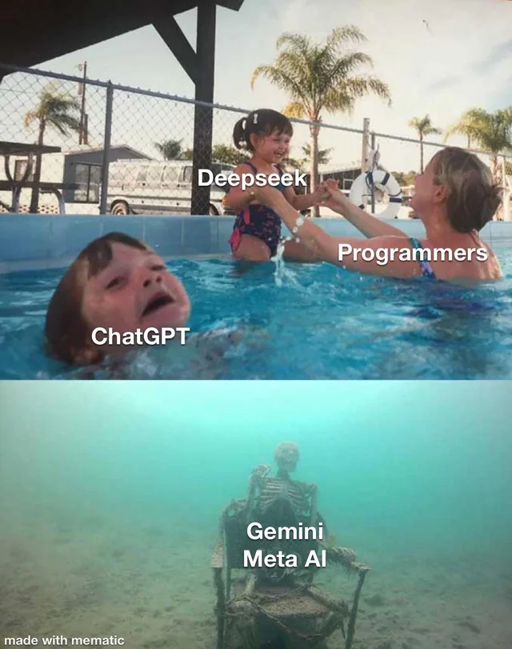
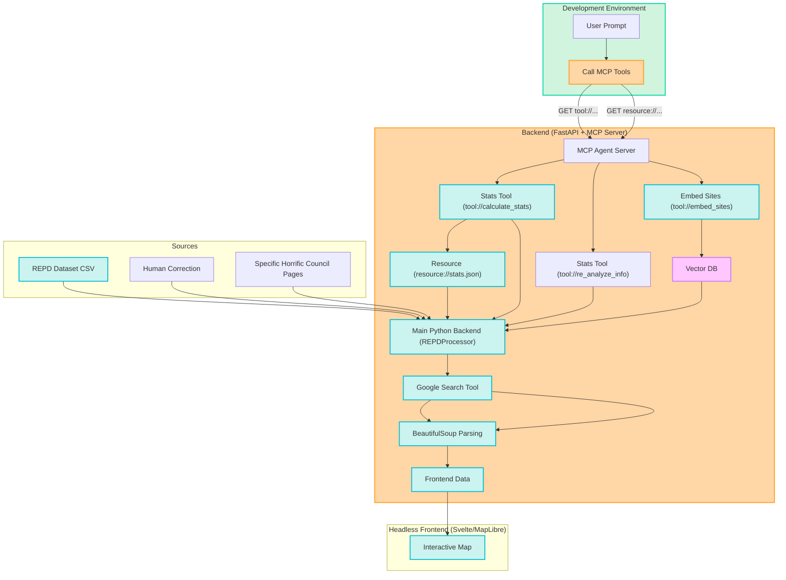

# The Clean Energy Graveyard

### What open data reveals about Britain's Renewable future

---

# Table of Contents


<div class="grid grid-cols-2 gap-4 mt-4 text-sm">

<div class="card">
  <div class="font-bold text-accent text-sm mb-2">Act I: Setting The Scene</div>
  <ul class="list-retro text-xs text-muted">
    <li>About Me (briefly, I promise)</li>
    <li>A Quick LLM Glossary</li>
    <li>The State of UK Renewables</li>
    <li>The Hypothesis: Blame The NIMBYs?</li>
  </ul>
</div>

<div class="card">
  <div class="font-bold text-accent text-sm mb-2">Act II: Building the Clean Energy Graveyard</div>
  <ul class="list-retro text-xs text-muted">
    <li>The REPD Dataset (it's messy)</li>
    <li>Clean Energy Graveyard V1</li>
    <li>Live Demo (what could go wrong)</li>
    <li>The Tech Stack & Gemini/MCP Thoughts</li>
  </ul>
</div>

<div class="card">
  <div class="font-bold text-accent text-sm mb-2">Act III: Lots of Graphs (Exciting!)</div>
  <ul class="list-retro text-xs text-muted">
    <li>What the AI Found (the good)</li>
    <li>What the AI Found (the unhinged)</li>
    <li>Upgrading to MCP</li>
    <li>Fun Data visualisations,  many of them</li>
  </ul>
</div>

<div class="card">
  <div class="font-bold text-accent text-sm mb-2">Act IV: What Does It All Mean?</div>
  <ul class="list-retro text-xs text-muted">
    <li>The Shoggoth of British Planning</li>
    <li>Was the hypothesis right? </li>
    <li>Open Source & What's Next</li>
  </ul>
</div>
</div>

<br> 

## What to expect in the next 30~ minutes
  - A (hopefully fun)  whirlwind walk through a bunch of different areas, from LLMs to Goose Sightings


---
layout: image-right
image: ./assets/avatar.png
transition: slide-left
---

# About Me

<p>
Senior Software Engineer & Creative Technologist 
</p>
  
<v-clicks>
All views expressed in this talk are personally my own, and do not reflect my employer.

- Led data analysis for large Industrial decarbonisation projects

- Work in Civil Nuclear AI deployment space & start-ups within renewable predictive maintenence

- Worked on cool tech art installations for different festivals 

- Love making weird little tech art projects 

</v-clicks>

<div class="abs-bl mx-14 my-12 flex flex-col gap-2">
  <div class="attribution">ends.substack.com · github/@dambem</div>
  <div class="attribution--subtle">bemben.co.uk</div>
</div>

---


# LLM Terminology

<div class="section-subtitle">Simple definitions for main terms</div>

<v-clicks>

- <b class="text-accent">Large Language Model (LLM)</b> — Machine learning model trained on the internet and pirated books.

- <b class="text-accent">Agents</b> — Giving an LLM access to tools, memory and planning, and selling it for £10 million.

- <b class="text-accent">Retrieval Augmented Generation (RAG)</b> — Giving an LLM access to correct context, so that it doesn't tell you to eat rocks.

- <b class="text-accent">Model Context Protocol (MCP)</b> — A protocol to let an LLM access controls in an application, so when it takes over the world, the process will at least be standardised.
</v-clicks>

---
layout: image-left
image: ./assets/thematics/thinking_machine.webp
---

# The Scale of Renewable Deployments in the UK

- 44% of Electricity Generated in 2025 via Renewables
- 23.825 GW Maximum Wind Generation 5th December
- 127 Twh of electrictiy generated yearly


https://www.neso.energy/news/britains-energy-explained-2025-review

---
layout: image
backgroundSize: contain   
image: ./assets/latest_visuals/overall.png

---

#

---
layout: cover
---

# The Hypothesis
<div class="section-subtitle">NIMBYism is a large obstacle to renewable energy deployment in the UK.</div>

We hear about NIMBYs all the time as one of the main reasons for lack of renewable energy deployment, but is there any data to support this?

How can we "quantify" the NIMBY menace, so we can better understand its impact?

---
layout: image
image: ./assets/latest_visuals/nimby_articles.png
---

---
layout: image
image: ./assets/latest_visuals/nimby_2.png
---

---
layout: image
image: ./assets/latest_visuals/nimby_3.png
backgroundSize: contain
---


---
layout: fact 
image: ./assets/thematics/don_quixote.webp
---

# What's a NIMBY?

<v-clicks>

<div class="stat-value stat-value--primary text-5xl mt-4">NOT IN MY BACKYARD</div>

<div class="section-subtitle mt-4">Organised practice of opposing new developments in someone's area (usually their own).</div>

<div class="section-subtitle">A very common theme in the media around lack of development within the UK.</div>

</v-clicks>

---
layout: image-right
image: ./assets/thematics/don_quixote.webp
---

# What do NIMBYs cause?

```bash {all|2|1-3|all}
$ grep "excuses.txt" -count "ruins my view"
612 matches found
```

<v-clicks>

- NIMBYism in Britain raises cost of windpower by <span class="text-accent font-bold">10–29%</span> (1)
- <span class="text-accent font-bold">80%</span> of Projects in EU are stuck in permission processes (2)
- Hard to differentiate valid reasons from anti-progress hysteria
- Mostly: a year of silly side projects 

</v-clicks>

<div class="source">
  1 — generationim.com · How Climate NIMBYism Prevents Net Zero<br>
  2 — vestas.com · EU Permitting Policy Recommendations
</div>

---
layout: iframe-right
url: ./assets/repd_data.mp4
---

# The Foundational Data

### Government Renewable Energy Planning  Dataset (REPD)
<v-clicks>

- Dataset containing every single renewable project since the 90s **over 150kW**
- Fields are all horribly described and empty in random spots
- Hard even for a human to work out what the projects might be
- Only readable for people who know how to get past the noise

### Other Issues
- Every Council has a different database of projects

</v-clicks>

---

# How do we make this data more accessible, understandable and fun?

### And alongside, how do we figure out the impact of NIMBYism on these projects? 


<v-clicks>

- Use AI to read through the media and council documents to find out which projects were cancelled due to NIMBYism, and which were cancelled for legitimate reasons.

- Build an interactive map to visualise the "Clean Energy Graveyard" across Britain, showing where projects were cancelled and why.

- Make it all open source so that anyone can contribute to the project and help build out the dataset and map. <b>(If anyone wants to help with this, please get in touch!)</b>

</v-clicks>

---
layout: image-right
image: ./assets/pokedex_image.png
---

# Clean Energy Graveyard V1

<div class="grid grid-cols-1 gap-3 mt-4">

<div class="card">
  <div class="font-bold text-accent text-sm">Cancelled Project Tracker</div>
  <div class="text-xs text-muted mt-1">Every refused & withdrawn UK renewable energy project in one place.</div>
</div>

<div class="card">
  <div class="font-bold text-accent text-sm">Interactive Map — MapLibre GL & Svelte</div>
  <div class="text-xs text-muted mt-1">Geospatial view of the renewable energy graveyard across Britain.</div>
</div>

<div class="card">
  <div class="font-bold text-accent text-sm">AI-Powered Analysis Using Google Gemini</div>
  <div class="text-xs text-muted mt-1">Quantifies and contextualises cancelled projects. Researches Media for likelihood of cancellation related to NIMBYism.
  </div>
</div>

</div>

---
layout: statement
---

# Live Demo

<div class="flex justify-center h-full items-center">
  <div class="glass p-4">
    
  </div>
</div>

---

# The Tech Stack (V1)

<div grid="~ cols-2 gap-4">
<div>

<div class="grid grid-cols-1 gap-2 mt-4">

<div class="card">
  <div class="font-bold text-accent text-sm mb-1">Backend</div>
  <ul class="list-retro text-xs text-muted">
    <li>Pandas & Geopandas - data processing & geospatial analysis</li>
    <li>Google Search API  - duct-taped retrieval</li>
    <li>Gemini AI - snarky analysis</li>
    <li>BeautifulSoup - ethical scraping</li>
    <li>MarkItDown - HTML → MD</li>
  </ul>
</div>

<div class="card">
  <div class="font-bold text-accent text-sm mb-1">Frontend</div>
  <ul class="list-retro text-xs text-muted">
    <li>Vite & Svelte</li>
    <li>MapLibre GL - fancy maps</li>
    <li>Chart.js - diagrams</li>
    <li>GSAP - smooth animations</li>
  </ul>
</div>

<div class="card">
  <div class="font-bold text-accent text-sm mb-1">Hosting</div>
  <div class="text-xs text-muted">Vercel — for hurting my wallet</div>
</div>

</div>

</div>
<div class="h-100 flex items-center">



</div>
</div>

---
layout: two-cols
---

# Thoughts On Gemini

<v-clicks>

- Gemini may be the (worst/best/in-between) of LLM litter (IT KEEPS CHANGING!!!)
- Pros:
  - Generous free tier (perfect for side projects)
  - Fast API response times
  - Excellent Python SDK integration
- Simple **MCP** & Custom Agent Integration
- Studio Toolset is great for integration with a host of different tools for early validation

</v-clicks>

::right::

<div class="mt-10 flex flex-col items-center">
  
  <p class="attribution--subtle mt-2 text-center">Reverse this</p>
</div>

---

# The Good

<v-clicks>

<div class="callout-success mt-4 text-sm">
  <div class="font-bold text-success mb-1">Successfully identified legitimate vs. frivolous concerns with correct ground truth</div>
  <ul class="text-xs text-muted mt-1">
    <li>Solar project on eastern side of landfill — denied for beauty concerns</li>
    <li>Famous BBC personality hates solar near his house</li>
    <li>A council member referred to it as a severe threat to the viability of the existing post office shop</li>
  </ul>
</div>

### Best Comments Found

<blockquote class="mt-3 text-sm">
  "severe threat to the viability of the existing post office shop" — Solar Farm & Battery Storage objection
</blockquote>

<blockquote class="mt-2 text-sm">
  "we've got hot rocks 5km hot and the hot rocks can produce electricity" <span class="text-faint text-xs">— Actual, genuine quote from a councillor</span>
</blockquote>
<blockquote class="mt-2 text-sm">

Loss of field for parking associated with the village fete.
</blockquote>

</v-clicks>


---

# Not Quite AGI: The Ugly 

<div grid="~ cols-3 gap-4">

<div class="col-span-2">

<div class='text-sm'>

<v-clicks>

- NIMBYdar sometimes took sassiness too far. :
  - Hates ancient woodland
  - Mistook BnB for an evil NIMBY
  - Enjoys referring to people as 'Meatbags'

<br>
<blockquote class="text-xs mt-2">"Oh, the roundabouts! Won't somebody think of the roundabouts?"</blockquote>
<blockquote class="text-xs mt-1">"Oh, a solar farm near Maggots End?  <br>I hope the residents aren't afraid of a little sunshine, <br> or perhaps they prefer the glow of their coal-powered lamps."</blockquote>

</v-clicks>

</div>
</div>
<div>

<div class="flex justify-center h-full items-center">
<div class="retro-readout">

```json
{
  "header": 
    "HARK! A SOLAR FARM FACES THE WRATH OF NIMBYISM! 
     Fears for ANCIENT WOODLAND and
     VISUAL DISRUPTION fuel the FRAY!",
  "Nimby Score": 78,
  "Accuracy Score": 95,
  "Petty Score": 55,
  "Organized Score": 65,
  "Political Leaning": 45,
  "Snide Commentary": 
    "Oh, the horrors of *renewable* energy 
     disrupting the *ancient* woodlands, 
     as if fossil fuels were planting trees. 
     For shame!"
}
```

</div>
</div>
</div>
</div>

---
layout: image-right
image: ./assets/latest_visuals/map.png
backgroundSize: contain

---

# Lessons for AI Integration

<v-clicks>

- Always set `max-tokens` & estimate for analysis length to avoid massive costs & model hallcuinations. (Some council documents contain a massive amount of information)
  
- Structured responses are key for keeping your sanity - especially when you step away from an open source project and come back to it.

- Each person I spoke to wanted something slightly different from the app, and i'm a people pleaser, resulting in a slight loss of identity

</v-clicks>

---

# Integration of Model Context Protocol for Development

<div class="section-subtitle">The V1 setup was simple  and quickly became chaotic.</div>

<v-clicks>
<div class="callout-warning mt-4 text-sm">
  <div class="font-bold text-warning mb-1">Problems with the naive approach</div>
  <ul class="text-xs text-muted">
    <li>Data changes often, better sources exist for specific renewables</li>
    <li>Ambiguous as to which article is "better"</li>
    <li>Different sources need different tools depending on structure (e.g, council websites) </li>
    <li>Wasted repeated searches producing no good results</li>
  </ul>
</div>

<hr>

<div class="grid grid-cols-1 gap-2 mt-2">

<div class="card">
  <div class="font-bold text-accent text-sm">Structured Backend Interaction</div>
  <div class="text-xs text-muted mt-1">MCP provides a clean protocol for the agent to call Python tools.</div>
</div>

<div class="card">
  <div class="font-bold text-accent text-sm">Separate Agnostic Agent</div>
  <div class="text-xs text-muted mt-1">Instructions to review, retry, and improve, without coupling to one LLM.</div>
</div>

<div class="card">
  <div class="font-bold text-accent text-sm">Reduces Burden</div>
  <div class="text-xs text-muted mt-1">Open-source project with no funding means maintenence is based on my whim - MCP Protocl for complex analysis helps identify sites.</div>
</div>

</div>

</v-clicks>
---

# Model Context Protocol - Is It Hard To Do?
<v-clicks>

````md magic-move

```python 
from fastapi import FastAPI
from funcs.scrape_and_analyse import scrape_content, gemini_process

app = FastAPI()

@app.post("/process-gemini")
def post_scrape_content(url: str, mime: str) -> str:
    """Scrape Content - Scrapes content into a maximum character limit with specific actions based on mimetypes.
    Args:
        url (str): URL of content to scrape
        mime (str): MimeType of Content To Scrape
    Returns:
        str: Scraped content as string.
    """
    return scrape_content(url, mime)

```

```python 
from fastapi import FastAPI
from funcs.scrape_and_analyse import scrape_content, gemini_process
from fastmcp import FastMCP

mcp = FastMCP("NimbyDex")
mcp_app = mcp.http_app(path='/mcp')

app = FastAPI()
app.mount("/mcp-server", mcp_app, "mcp")

@app.post("/process-gemini")
def post_scrape_content(url: str, mime: str) -> str:
    """Scrape Content - Scrapes content into a maximum character limit with specific actions based on mimetypes.
    Args:
        url (str): URL of content to scrape
        mime (str): MimeType of Content To Scrape
    Returns:
        str: Scraped content as string.
    """
    return scrape_content(url, mime)

```
```python 
from fastapi import FastAPI
from funcs.scrape_and_analyse import scrape_content, gemini_process
from fastmcp import FastMCP

mcp = FastMCP("NimbyDex")
mcp_app = mcp.http_app(path='/mcp')

app = FastAPI()
app.mount("/mcp-server", mcp_app, "mcp")

@mcp.tool()
def post_scrape_content(url: str, mime: str) -> str:
    """Scrape Content - Scrapes content into a maximum character limit with specific actions based on mimetypes.
    Args:
        url (str): URL of content to scrape
        mime (str): MimeType of Content To Scrape
    Returns:
        str: Scraped content as string.
    """
    return scrape_content(url, mime)

```
````


</v-clicks>
---

# Development Flow with MCP


<div grid="~ cols-2 gap-4">

<div class="h-100 flex items-center">



</div>
</div>
---

# Lightning Lessons

### If working with LLMS - always wrap them in a agnostic client class, don't be locked in on one model.

```python
class BaseClient(Protocol):
    """Base class for clients that interact with LLMS"""
    api_key: str
    def call(self, prompt: str, options: MessageOptions=MessageOptions(), **kwargs) -> MessageResponse:
        """Make a call to the LLM with the given prompt and return the response text."""
        ...
    def call_json(self, prompt:str, json_model:BaseModel, options: MessageOptions=MessageOptions(), **kwargs) -> MessageResponse:
        """Make a call to the LLM with given prompt and json serializable model, return as valid json."""
        ...
    
    async def call_json_async(self, prompt:str, json_model:BaseModel, options: MessageOptions=MessageOptions(), **kwargs) -> MessageResponse:
        """Make a call to the LLM with given prompt and json serializable model, return as valid json."""
        ...
```

---

# Lightning Lessons

### Re-projecting is neater with `pyproj` than geopandas, and provides you with a little more control for errors

```python

        transformer = Transformer.from_crs(from_crs, to_crs)
        df[easting_col] = pd.to_numeric(
            df[easting_col].astype(str).str.strip(), errors="coerce"
        )
        df[northing_col] = pd.to_numeric(
            df[northing_col].astype(str).str.strip(), errors="coerce"
        )
        df = df.dropna(subset=[northing_col, easting_col])
        lat, lon = transformer.transform(
            df[easting_col].values, df[northing_col].values
        )
        df["lat"] = lat.round(4)
        df["lon"] = lon.round(4)
        df.drop(columns=[easting_col, northing_col])
        return df
```

---

# Lightning Lessons

### If you work a lot with geojson & JS, Svelte feels way less overwhelming than react

While my frontend is still a mess - Svelte makes it way easier to actually have re-usable components for future work.

```js
export async function addLocalAuthoritiesSource(map, geojsonData) {
    map.addSource('local-authorities',  {
        type: 'geojson',
        data: geojsonData
    });
}
```

---

# Does the main REPD data support the hypothesis that NIMBYism is a large barrier to renewable energy projects?

### Partially - but it also revealed a much larger problem with the planning system itself.

- (WARNING - LOTS OF GRAPHS INCOMING)

--- 
layout: image
image: ./assets/latest_visuals/output.png
backgroundSize: contain
---


--- 
layout: image
image: ./assets/latest_visuals/time_waiting.png
backgroundSize: contain
---

--- 
layout: image
image: ./assets/latest_visuals/bubble.png
backgroundSize: contain
---

--- 
layout: image
transition: fade
image: ./assets/latest_visuals/total.png
backgroundSize: contain
---

--- 
layout: image
transition: fade
image: ./assets/latest_visuals/succesful.png
backgroundSize: contain
---


--- 
layout: image
transition: fade
image: ./assets/latest_visuals/unsuccesful.png
backgroundSize: contain
---

--- 
layout: image
image: ./assets/latest_visuals/awaiting_construction.png
backgroundSize: contain
---


---
layout: image-left 
image: ./assets/shoggoth.jpeg
---

# The Shoggoth Of British Planning

<v-clicks>

<div class="section-subtitle">NIMBYs only seem to be a small part of the problem.</div>

<div class="callout-danger mt-4 text-sm">
  <div class="font-bold text-danger mb-1">Massive backlog of energy connections.</div>
  <ul class="text-xs text-muted mt-1">
    <li>Long wait for connections - leading to lengthier under construction periods</li>
    <li>Planning system becomes overwhelmed with the volume of applications</li>
    <li>Byzantine decision-making processes </li>
    <li>Hundreds of documents for a 150kW solar farm</li>
  </ul>
</div>

</v-clicks>

---
layout: image-left
image: ./assets/faw_side.png
---
# A Terrifying Study

**Faw Side Community Wind Farm**  
315MW, 45 Turbines

<v-clicks>

<div class="section-subtitle mt-2">How long do you think this took to refuse?</div>

<div class="stat-value stat-value--danger text-5xl mt-4">4.589 Years</div>

<div class="callout-danger mt-4 text-sm">
  <div class="font-bold text-danger mb-1">496 Total Documents</div>
  <div class="text-xs text-muted">111 Public Representations · 285 Application Documents</div>
</div>

<div class="section-subtitle mt-3">Kafka would turn in his grave.</div>

</v-clicks>

<div class="mt-8 flex justify-center">
  
</div>

---
layout: image-left
image: ./assets/latest_visuals/goose_sighting.webp
---

# Faw Side Cont

<v-clicks>

- 11 different bird spotting documents
- HotTip: If you're interested in bird spotting, use public renewable planning documents to find where the best spots are. 


- 111 documents of public representation and objections
- 335 Objections, but over 500 letters of support
  
- 285 total Application Documents from bird spotting to cultural trust 
</v-clicks>

---

# Does the tracker support the hypothesis that NIMBYism is a large barrier to renewable energy projects?


---
layout: image
backgroundSize: contain
image: ./assets/latest_visuals/nimby_level.png
---

---

# There seems to be a slight correlation betwen a high NIMBY score and an average longer delay - but it's difficult to say.

---
layout: image-right
backgroundSize: contain
image: ./assets/latest_visuals/training_curve.png

---
# Can we use traditional ML to tell the scale of the issue?

Train small neural MLP network to try and predict whether a project is likely to be cancelled due to NIMBYism based on the text of the objections and the project details.

Feed that within the results of the REPD dataset and clean renewable graveyard gemini analysis to try and get a better understanding of the impact of NIMBYism on these projects.


---

# Evaluation
<v-clicks>

- Struggled to get a decent classification - most likely due to size of data & amount of NIMBY analysis

-  Local authority alignment and project type were the most important features, which suggests that the model is picking up on some of the underlying patterns in the data, but it's not able to provide a definitive answer as to the impact of NIMBYism on these projects.

Plus - since we're researching cancelled projects, the data is very imbalanced, which makes it hard for the model to learn effectively.

- Better data retrieval for council documents could be interesting.
- Increase size of dataset by encoding each project based on date - allowing "live" project nature for training

- I'm also a little out of my depth and there's so much data!

</v-clicks>

---

# So was my original hypothesis correct?

<v-clicks>

<div class="callout-info mt-4 text-sm">
  <div class="font-bold mb-1">"THERE IS AS YET INSUFFICIENT DATA FOR A MEANINGFUL ANSWER." </div>
  <div class="text-xs text-muted">NIMBYs seem to be a weirdly small part of the problem despite the outsized outcry. The planning system itself is the real obstruction. While NIMBYs may play a factor in slowing down projects, they are not the primary obstacle to why so many projects are not being deployed.</div>
</div>

Re-aligning the C.E.G instead, using it as a tool to be able to monitor and analyse renewable energy project more effectively.

I'd love to enlist some help from the PyData London community.

Get in touch if you want to help out with the project, or if you have any ideas for how to improve the analysis or the dataset.

My first couple of initial queries to the community found a few details:

- There's currently a massive slow-down due to large backlog in connections


</v-clicks>

---
layout: image-right
image: ./assets/latest_visuals/qr-code-open-source.png
backgroundSize: contain
---
# Making the dataset & repository open

The Clean Energy Graveyard has become open for open source contribution.  

I've also made a cleanly processed version of the REPD dataset available on github, including geospatial mapping projection & cleaned up data fields, to make it more accessible for other people to use and contribute to.


---

# Future Improvements

<v-clicks>

- Continue investigating the "Planning" Shoggoth
- Generalise the Clean Energy Graveyard to analyse overall decision making process
- Work out where to get connection limitation data
- Build out council application tool based on MCP work

</v-clicks>

---
layout: statement
---

# AI isn't the interesting part, it's what makes the data more exciting to read.

<v-clicks>

<div class="section-subtitle mt-6">C.E.G is more a graveyard for lost renewable projects than anything else. <br>The robot just makes the experience slightly less depressing.</div>

</v-clicks>

---
layout: center
class: "text-center"
---

# Thanks for listening!


<div class="mt-6 text-sm text-muted">

**Live:** [nimby.bemben.co.uk](https://nimby.bemben.co.uk) 

**Next Article:** The Futurological AI Congress (how fast does it kill everyone?) 
</div>

<div class="flex justify-center gap-8 mt-4">
  <div class="card text-center p-4">
    
    <div class="attribution--subtle mt-2">ends.substack.com</div>
  </div>
  <div class="card text-center p-4">
    
    <div class="attribution--subtle mt-2">linkedin.com/in/bemben</div>
  </div>
</div>
- All creative commons images from - https://www.cosmos.so/public-work/fun
- 


